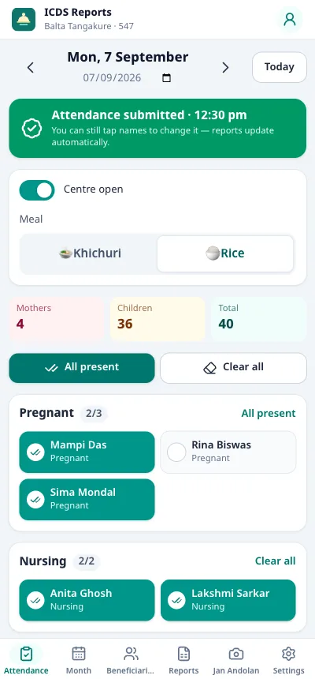
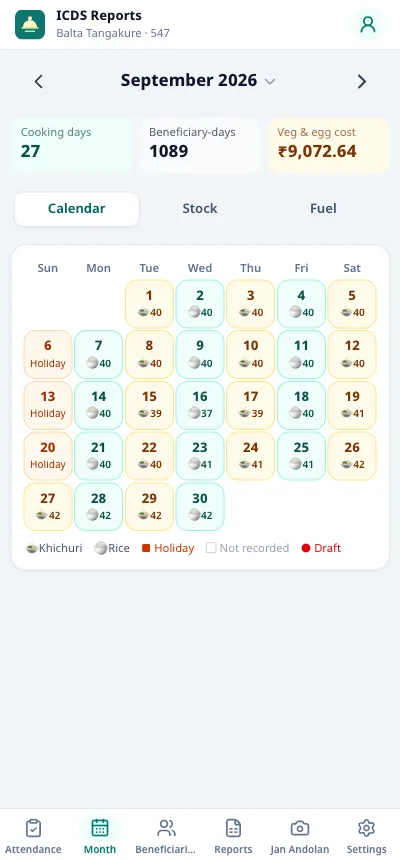
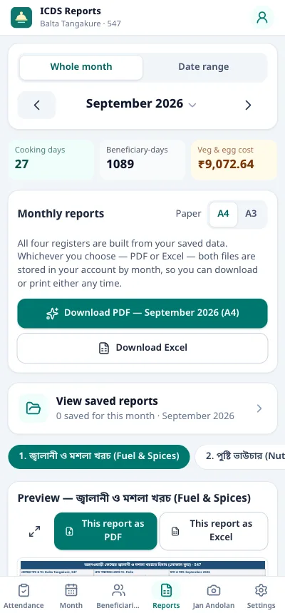
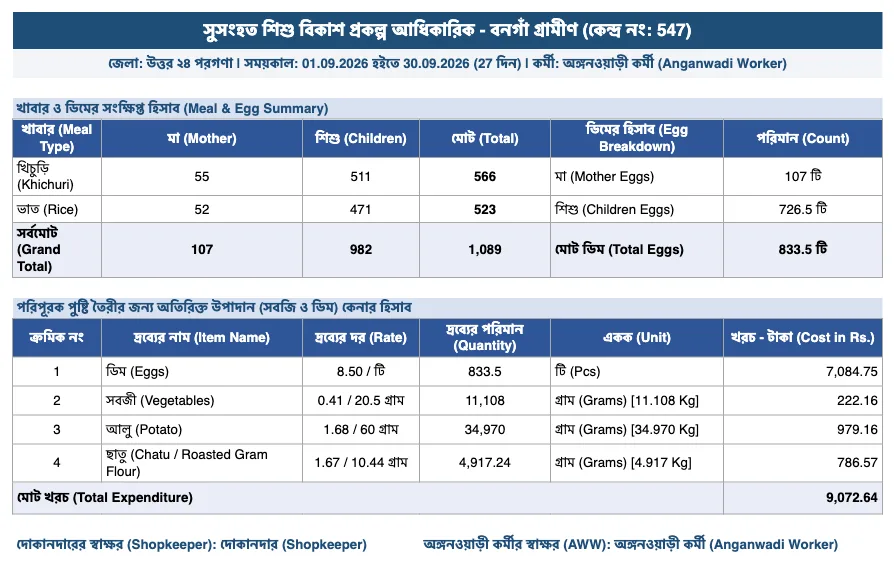

# ICDS Report Generator

[](https://github.com/dasabhishekdev/icds-report-generator/actions/workflows/ci-cd.yml)
[](LICENSE)

An open-source web app (and Android app) for Anganwadi workers under India's Integrated Child Development Services (ICDS) scheme. Workers record daily attendance; the app calculates rations and costs and produces the four monthly ICDS registers as Excel or PDF:

- Fuel & Spices
- Nutrition Voucher
- SNP Veg & Egg
- Stock & Consumption

Live instance: [icds.educoreva.com](https://icds.educoreva.com). The defaults (norms, rates, age categories, the bilingual Bengali/English register layouts and the holiday calendar) follow West Bengal practice, and every value is editable per centre.

<p>
  
  
  
</p>


## Features

- **Multi-user.** Each worker registers their own account; all data is stored per user in MongoDB and every query is scoped to the signed-in user. A new account starts with default norms, rates, age categories and fuel items; the centre name, number and worker name are the user's own.
- **Attendance and calculations.** Daily attendance with submit/check-in, automatic ration quantities (rice, dal, oil, salt, eggs, vegetables, potato, chatu) and costs, plus stock and fuel tracking.
- **Reports.** Choose a whole month or a date range (up to 93 days), A4 or A3. All four registers are generated on the server as a vector PDF (headless Chromium, Bengali font embedded) and as Excel with live formulas, saved per user, and listed under **Saved reports**.
- **Age categories from date of birth.** Children move between categories the day after completing the boundary age (3–6 years from 3 years + 1 day). A child without a date of birth is flagged until it is added.
- **Holidays.** West Bengal government holidays are downloaded each year and cached; the current year is built in for offline use. Each centre chooses all holidays, List-I only, or none.
- **Jan Andolan photos.** Activity photos up to 30 MB are compressed on the phone to under 1.5 MB (the Poshan Abhiyaan portal limit is 2 MB), named consistently, and saved. Portal credentials can be stored encrypted (AES-256-GCM) with copy buttons and direct links to the portal.
- **Installable.** PWA with offline shell, plus a Trusted Web Activity Android app in `android/`.
- **Bilingual UI.** Bengali and English.

## Tech stack

| Part | Where | Stack |
|------|-------|-------|
| Web app | `src/` | React 19, Vite, Tailwind CSS 4, PWA. The calculation engine and report builders run in the browser for the live preview. |
| API | `server/` | Fastify 5, MongoDB driver, zod validation, cookie sessions, scrypt password hashing |
| Report service | `server/src/reports/` | Puppeteer PDF, ExcelJS, S3 or disk storage |
| Containers | `Dockerfile`, `docker-compose.yml` | nginx (`icds-web`), Node API (`icds-api`), MongoDB 7 (`icds-mongo`) |
| Android | `android/` | Bubblewrap Trusted Web Activity |

## Getting started

Requirements: Node.js 22+, Docker (for MongoDB), and Chrome or Chromium for PDF generation.

```bash
git clone https://github.com/dasabhishekdev/icds-report-generator.git
cd icds-report-generator
npm ci

# MongoDB for development
docker run -d --name icds-dev-mongo -p 127.0.0.1:27017:27017 mongo:7

# API on http://localhost:4000
MONGO_URL=mongodb://127.0.0.1:27017/icds COOKIE_SECURE=false PORTAL_SECRET=$(openssl rand -hex 32) npm run dev:api

# Web app on http://localhost:5173 (proxies /api to the API)
npm run dev
```

Open http://localhost:5173 and register an account.

### Run the full stack in Docker

```bash
cp .env.example .env             # set MONGO_ROOT_PASSWORD to a long random hex string
docker network create web        # once; the web container joins this network
docker compose -f docker-compose.yml -f docker-compose.local.yml up -d --build
# → http://localhost:8084
```

### Configuration

All settings are environment variables; `.env.example` documents each one.

| Variable | Purpose |
|----------|---------|
| `MONGO_ROOT_USER`, `MONGO_ROOT_PASSWORD` | MongoDB credentials for the Docker stack (password must be hex) |
| `COOKIE_SECURE` | `true` in production (HTTPS required); `false` only for plain `http://localhost` |
| `ALLOW_REGISTRATION` | `false` stops new sign-ups |
| `HOLIDAY_SYNC` | `false` for servers without outbound internet; uses cached/built-in holiday lists |
| `PORTAL_SECRET` | 64 hex characters (`openssl rand -hex 32`) encrypting saved portal passwords; without it, saving portal logins is disabled |
| `S3_BUCKET`, `S3_REGION`, `S3_ACCESS_KEY_ID`, `S3_SECRET_ACCESS_KEY`, `S3_ENDPOINT`, `S3_FORCE_PATH_STYLE`, `S3_PREFIX` | Report and photo storage. Leave `S3_BUCKET` empty to store files in a Docker volume instead. |

## Testing and building

```bash
npm run typecheck
MONGO_URL=mongodb://127.0.0.1:27017 npm test
npm run build                    # dist/ (web app) and dist-server/index.cjs (API bundle)
```

- API tests are skipped without `MONGO_URL`.
- PDF tests use a local Chrome/Chromium, or the browser at `CHROME_PATH`.
- S3 tests run only with `S3_TEST_ENDPOINT` set (for example, against `adobe/s3mock`).

## Project structure

```text
src/
  domain/       calculation engine: months, eligibility, age bands, holidays
  reports/      register builders shared by the preview and the server (HTML, Excel)
  pages/        screens (attendance, month, beneficiaries, reports, settings, …)
  i18n/         Bengali and English strings
  lib/          image compression worker, downloads, geolocation
server/
  src/          Fastify app, auth, data routes, holidays, photos, portal logins, reports
  test/         API, report, holiday and photo tests
android/        Trusted Web Activity wrapper
deploy/nginx/   nginx config for the web container
scripts/        deploy, backup and Android publish scripts
docs/           deployment guide and design notes
```

## How it works

**Report generation.** The server builds the registers from saved data with the same code as the on-screen preview, prints them to PDF with headless Chromium and writes Excel with live formulas. Each generation is stored at `<S3_PREFIX>/users/<userId>/<YYYY-MM>/<reportId>/…` in S3, or in the `icds-reports-data` volume when `S3_BUCKET` is empty.

**Holidays.** West Bengal publishes its holiday list only as a yearly Finance (Audit) Department PDF, so there is no official API. The server (`server/src/holidays/`) downloads each year from a keyless iCal transcription of the notification (List-I and List-II), falls back to the India Calendar API (List-I only), caches it in the `holidayCalendars` collection, and re-checks this year and next every few hours. Centres can mark any state holiday as "Not a holiday".

**Photo compression.** A Web Worker (`src/lib/compressImage.worker.ts`) keeps full resolution at the highest JPEG quality that fits under 1.5 MB (at least 0.80), otherwise downscales just enough, never below 1920 px on the longest side. JPEG/PNG files already under 1.5 MB are kept unchanged. The search is `chooseEncoding` in `src/lib/imageEncoding.ts`. The app never automates the Poshan portal; the worker submits the form themselves.

**Portal passwords.** Stored in the `portalLogins` collection, encrypted with AES-256-GCM using `PORTAL_SECRET`. Changing the key makes saved passwords unreadable, and workers have to enter them again.

## Deployment

See [docs/DEPLOYMENT.md](docs/DEPLOYMENT.md) for the production container layout, CI/CD, backups, S3 storage and the Android app.

## Contributing

Contributions are welcome: bug reports, register layouts for other states, translations, and code. Please read [CONTRIBUTING.md](CONTRIBUTING.md) and follow the [Code of Conduct](CODE_OF_CONDUCT.md). To report a security issue, see [SECURITY.md](SECURITY.md) instead of opening a public issue.

## License

[MIT](LICENSE) © 2026 Abhishek Das (Educoreva)
